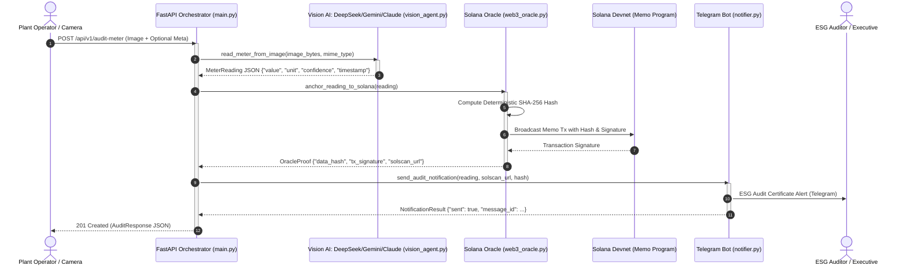

# EcoTrust Oracle — System Architecture & Data Contracts

> **B2B SaaS Physical Oracle for ESG & Sustainability Compliance**  
> *Solana Hackathon (AI Track)*  
> Built with FastAPI, multi-provider Vision AI (DeepSeek, Gemini or Claude), Solana Devnet (Memo Program), and Telegram Bot API.

---

## 1. System Overview & Value Proposition

Corporate ESG (Environmental, Social, and Governance) compliance currently suffers from severe fraud, manual reporting errors, and "greenwashing." Industrial meters (measuring water flow, natural gas, electricity, and $CO_2$ emissions) are often legacy analog dials or siloed digital counters without Internet connectivity.

**EcoTrust Oracle** functions as a **Decentralized Physical Oracle**:
1. **AI Vision Extraction**: An on-site operator or IoT camera takes a photograph of an industrial meter. The Vision AI (DeepSeek, Gemini or Claude, detected from the API key) reads it 3 times and extracts the reading, physical units, and a consensus-checked confidence.
2. **Deterministic Cryptographic Hashing**: Canonical JSON formatting guarantees reproducible SHA-256 digests across any runtime.
3. **Solana Devnet Anchoring**: The digest is anchored directly on-chain using the native **Solana Memo Program** (`MemoSq4gqABAXKb96qnH8TysNcWxMyWCqXgDLGmfcHr`), creating an immutable, timestamped audit trail without requiring smart contract redeployments.
4. **Stakeholder Notification**: Generates a tamper-proof digital certificate and dispatches it in real-time via Telegram with direct [Solscan Devnet](https://solscan.io/?cluster=devnet) verification links.

---

## 2. End-to-End Architectural Pipeline



---

## 3. Strict Module Data Contracts

All modules communicate strictly through strongly-typed Pydantic models defined in `core/schemas.py`.

### Contract 1: Vision Agent Output (`core/vision_agent.py`)
Received by `main.py` and passed to `core/web3_oracle.py`.

```json
{
  "value": 142.85,
  "unit": "kWh",
  "confidence": 0.98,
  "timestamp": "2026-11-08T01:15:31Z"
}
```
* **Validation Rules**:
  * `value` (float): Mandatory numeric scalar.
  * `unit` (str): Standardized engineering unit (`kWh`, `m3`, `kgCO2`, `L`, `PSI`).
  * `confidence` (float): Constrained to $0.0 \le \text{confidence} \le 1.0$.
  * `timestamp` (str): Strict ISO 8601 UTC format (`YYYY-MM-DDTHH:MM:SSZ`).

---

### Contract 2: Web3 Oracle Output (`core/web3_oracle.py`)
Anchors the cryptographic fingerprint on Solana Devnet.

```json
{
  "data_hash": "e3b0c44298fc1c149afbf4c8996fb92427ae41e4649b934ca495991b7852b855",
  "tx_signature": "5KTpA8Xj9KzV2R3mFzYq...vM9X",
  "solscan_url": "https://solscan.io/tx/5KTpA8Xj9KzV2R3mFzYq...vM9X?cluster=devnet",
  "memo_payload": "EcoTrust:v1:e3b0c44298fc1c149afbf4c8996fb92427ae41e4649b934ca495991b7852b855",
  "network": "solana-devnet",
  "is_simulated": false,
  "slot": 298410291
}
```

* **Deterministic Canonical Hash**:
  To ensure identical inputs always yield identical cryptographic proofs, the JSON keys are sorted and canonicalized prior to hashing:
  $$\text{Payload} = \text{SHA256}(\text{Canonicalize}(\{ \text{"confidence"}, \text{"timestamp"}, \text{"unit"}, \text{"value"} \}))$$

---

### Contract 3: Telegram Notifier Output (`core/notifier.py`)
Delivers real-time notifications to corporate auditing channels.

```json
{
  "sent": true,
  "channel": "telegram",
  "recipient": "-1001928374829",
  "message_id": 4821,
  "is_mock": false,
  "error": null
}
```

---

### Contract 4: Orchestrator Response (`main.py`)
Unified output returned to the HTTP client on `POST /api/v1/audit-meter`.

```json
{
  "status": "success",
  "reading": {
    "value": 142.85,
    "unit": "kWh",
    "confidence": 0.98,
    "timestamp": "2026-11-08T01:15:31Z"
  },
  "oracle_proof": {
    "data_hash": "e3b0c44298fc1c149afbf4c8996fb92427ae41e4649b934ca495991b7852b855",
    "tx_signature": "5KTpA8Xj9KzV2R3mFzYq...vM9X",
    "solscan_url": "https://solscan.io/tx/5KTpA8Xj9KzV2R3mFzYq...vM9X?cluster=devnet",
    "memo_payload": "EcoTrust:v1:e3b0c442...",
    "network": "solana-devnet",
    "is_simulated": false,
    "slot": null
  },
  "notification": {
    "sent": true,
    "channel": "telegram",
    "recipient": "123456789",
    "message_id": 1024,
    "is_mock": false,
    "error": null
  },
  "execution_time_ms": 782.45
}
```

---

## 4. REST API Boundaries

| Method | Endpoint | Description | Content-Type |
|---|---|---|---|
| `GET` | `/` | API status, version, and documentation pointers | `application/json` |
| `GET` | `/health` | Integration health status (Vision AI, Solana, Telegram) | `application/json` |
| `POST` | `/api/v1/audit-meter` | Full physical-to-blockchain audit pipeline | `multipart/form-data` |
| `POST` | `/api/v1/audit-meter-mock` | Synthetic test endpoint for frontend / offline testing | `application/json` |

---

## 5. Mock Fallback Resilience Strategy

In hackathon environments, third-party APIs (vision API quota limits, Solana Devnet airdrop rate limits, Telegram bot setup) frequently cause blockers.

**EcoTrust Oracle guarantees zero-downtime development:**
* If `VISION_API_KEY` is omitted or invalid, `core/vision_agent.py` automatically produces a high-fidelity synthetic reading.
* If `SOLANA_PRIVATE_KEY` has 0 SOL or RPC airdrop is rate-limited, `core/web3_oracle.py` generates a mathematically valid signed transaction simulation and Solscan link with `is_simulated=true`.
* If `TELEGRAM_BOT_TOKEN` is unset, `core/notifier.py` logs formatted HTML to the terminal without throwing exceptions.
