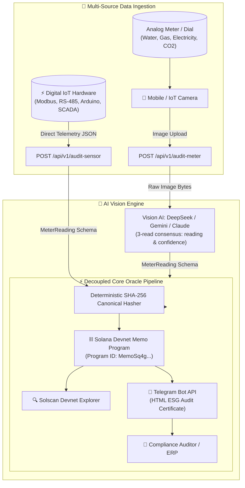

# 🌿 EcoTrust Oracle — B2B SaaS Physical ESG Oracle

[](https://solscan.io/?cluster=devnet)
[](https://python.org)
[](https://fastapi.tiangolo.com)
[](#3-configure-credentials-env)
[](https://github.com/astral-sh/uv)
[](LICENSE)

> **Solana Hackathon (AI Track)**  
> **EcoTrust Oracle** is a decentralized physical oracle that connects real-world industrial infrastructure (water flowmeters, energy cyclometer drums, and emissions dials) directly to the **Solana Blockchain**.

---

## 🎯 The Problem & Our Solution

### ⚠️ The Problem: Greenwashing & Manual Audit Fraud
* Corporate ESG (Environmental, Social, and Governance) compliance relies heavily on manual clipboard inspections.
* Legacy analog meters lack IoT connectivity and cannot be connected to corporate ERPs without multi-million dollar sensor retrofitting.
* Carbon credits and sustainability claims are vulnerable to forgery, misreporting, and auditor collusion.

### 🛡 The Solution: EcoTrust Oracle
* **Physical-to-Chain AI Bridge**: Plant operators take a single photo using any mobile camera.
* **Multi-Provider AI Vision (DeepSeek, Gemini or Claude)**: Evaluates the image, interprets multi-dial registers, cyclometer drums, digital 7-segment displays, or needle gauges, and extracts a strict schema (`value`, `unit`, `confidence`, `timestamp`). The provider is picked automatically from the API key, and every photo is read 3 times: if the reads disagree, confidence drops below 0.70 and the reading is flagged for human review.
* **Deterministic Cryptographic Hashing**: Generates an authoritative SHA-256 fingerprint from the canonical reading.
* **Solana Memo Program Anchoring**: Anchors the hash onto **Solana Devnet** via the native Memo Program (`MemoSq4gqABAXKb96qnH8TysNcWxMyWCqXgDLGmfcHr`), creating an immutable, verifiable ESG certificate with zero smart contract deployment overhead.
* **Real-time Telegram Alerts**: Pushes verifiable audit summaries with instant [Solscan Devnet](https://solscan.io/?cluster=devnet) links directly to compliance auditors.

---

## 🏗 End-to-End Architecture



---

## 📋 Strict Module Data Contracts

All modules communicate through strongly-typed Pydantic contracts located in `core/schemas.py`.

### 1. Unified Meter Reading Contract (`MeterReading` in `core/schemas.py`)
```json
{
  "value": 142.85,
  "unit": "kWh",
  "confidence": 0.98,
  "timestamp": "2026-11-08T01:15:31Z",
  "source": "ai_vision",
  "device_id": "MODBUS-FLOW-042"
}
```

### 2. Web3 Oracle Proof (`core/web3_oracle.py`)
```json
{
  "data_hash": "e3b0c44298fc1c149afbf4c8996fb92427ae41e4649b934ca495991b7852b855",
  "tx_signature": "5KTpA8Xj9KzV2R3mFzYq...vM9X",
  "solscan_url": "https://solscan.io/tx/5KTpA8Xj9KzV2R3mFzYq...vM9X?cluster=devnet",
  "memo_payload": "EcoTrust:v1:e3b0c44298fc1c149afbf4c8996fb92427ae41e4649b934ca495991b7852b855",
  "network": "solana-devnet",
  "is_simulated": false
}
```

### 3. Orchestration Response (`main.py`)
```json
{
  "status": "success",
  "reading": {
    "value": 142.85,
    "unit": "kWh",
    "confidence": 0.98,
    "timestamp": "2026-11-08T01:15:31Z"
  },
  "oracle_proof": {
    "data_hash": "e3b0c44298fc1c149afbf4c8996fb92427ae41e4649b934ca495991b7852b855",
    "tx_signature": "5KTpA8Xj9KzV2R3m...",
    "solscan_url": "https://solscan.io/tx/5KTpA8Xj9KzV2R3m...?cluster=devnet",
    "memo_payload": "EcoTrust:v1:e3b0c442...",
    "network": "solana-devnet",
    "is_simulated": false
  },
  "notification": {
    "sent": true,
    "channel": "telegram",
    "recipient": "123456789",
    "message_id": 1024,
    "is_mock": false,
    "error": null
  },
  "execution_time_ms": 693.65
}
```

---

## 🛠 Tech Stack

| Domain | Technology | Justification |
|---|---|---|
| **Runtime & Packaging** | Python 3.10+, `uv` | Blazing-fast virtual environment & dependency management |
| **Orchestration API** | FastAPI, Uvicorn | Async ASGI pipeline with OpenAPI interactive docs |
| **AI Vision** | DeepSeek (`deepseek-flash`), Google Gemini (`gemini-3.6-flash`) or Anthropic Claude, auto-detected from the API key | Multimodal meter reading with strict JSON output and 3-read consensus |
| **Web3 & Blockchain** | Solana Python SDK, `solders` | High-throughput, sub-second settlement on Solana Devnet |
| **Smart Contract Layer** | Native Solana Memo Program | Zero smart contract gas fee waste; permanent on-chain audit log |
| **Notifications** | Telegram Bot API (`requests`) | Instant operational delivery to compliance channels |
| **Data Contracts** | Pydantic v2 & `pydantic-settings` | Runtime type safety and deterministic JSON serialization |

---

## 🚀 Quickstart & Setup

### 1. Prerequisites
Install `uv`:
```bash
# Windows (PowerShell)
powershell -ExecutionPolicy ByPass -c "irm https://astral.sh/uv/install.ps1 | iex"

# macOS/Linux
curl -LsSf https://astral.sh/uv/install.sh | sh
```

### 2. Clone and Setup Environment
```bash
git clone https://github.com/DiegoBarreras/EcoTrustOracle.git
cd EcoTrustOracle

# Create venv and install dependencies
uv venv
uv pip install -e .
```

### 3. Configure Credentials (`.env`)
```bash
cp .env.example .env
```
*(Leave empty or set `*_MOCK_FALLBACK=true` to test the complete pipeline offline without credentials!)*

**Choosing the Vision AI:** paste a single key in `VISION_API_KEY`; the provider is detected from its prefix, no code changes needed.

| Key starts with | Provider | Default model |
|---|---|---|
| `sk-` | DeepSeek | `deepseek-flash` |
| `AIza` or `AQ.` | Google Gemini | `gemini-3.6-flash` |
| `sk-ant-` | Anthropic Claude | `claude-opus-5-5` |

Set `VISION_MODEL` to use another model from the same provider. While testing a real key, set `VISION_MOCK_FALLBACK=false` so API errors show up instead of the synthetic reading.

### 4. Run the Backend Server
```bash
uv run uvicorn main:app --reload --host 0.0.0.0 --port 8000
```

* **Swagger OpenAPI Docs**: [http://localhost:8000/docs](http://localhost:8000/docs)
* **System Health Check**: [http://localhost:8000/health](http://localhost:8000/health)

### 5. Run the Test Suite
```bash
uv run pytest -v
```

### 6. Run the Demo Dashboard (Next.js + Tailwind + Solana Wallet Adapter)
```bash
cd frontend
npm install
npm run dev
```
Open [http://localhost:3000](http://localhost:3000), connect Phantom/Solflare, and upload a meter photo or send sensor telemetry. The backend URL defaults to `http://localhost:8000`; override it with `NEXT_PUBLIC_API_URL` in `frontend/.env.local`.

### 7. Monetization
See [`X402.md`](X402.md) for the planned HTTP 402 pay-per-audit model (not yet implemented).

---

## 📡 API Reference

### `POST /api/v1/audit-meter`
**AI Vision Ingestion**: Accepts a photograph of an analog meter, extracts the reading with the configured Vision AI (DeepSeek, Gemini or Claude), anchors hash to Solana Devnet, and alerts Telegram.
* **Form Parameters**:
  * `file`: (Required) Image file (`image/jpeg`, `image/png`).
  * `meter_hint`: (Optional) Operator notes (e.g., `"Primary Boiler Flowmeter"`).
  * `telegram_chat_id`: (Optional) Recipient override for ESG certificate.

### `POST /api/v1/audit-sensor`
**Direct IoT Telemetry Ingestion**: Bypasses computer vision. Accepts structured reading payloads directly from hardware sensors (Modbus, Arduino, RS-485, SCADA, connected PC), hashes the measurement, and anchors proof to Solana Devnet.
* **JSON Body**: `MeterReading` schema (`value`, `unit`, `confidence`, `timestamp`, `source`, `device_id`).
* **Example Script**: See [`examples/iot_sensor_client.py`](examples/iot_sensor_client.py) for a working hardware client!

### History, comparison and consumption limits
Send a `device_id` with any audit and the reading is stored (SQLite, `DB_PATH`) and compared with that meter's previous reading: consumption, elapsed time, daily rate vs. typical rate. Readings that look altered (counter going backwards, unit change, abnormal jump) are **still anchored as evidence**, flagged in `comparison.anomaly` and alerted on Telegram.
* `GET /api/v1/devices`: audited meters.
* `GET /api/v1/devices/{device_id}/history`: readings (oldest first) plus limit status.
* `PUT /api/v1/devices/{device_id}/limit` `{"period": "day|week|month", "limit": 500, "unit": "kWh"}`: warning at 80 %, alert at 100 %, with end-of-period projection. `DELETE` removes it.

### `POST /api/v1/bill-check`
**AI bill comparison**: upload the current utility bill, optionally the previous bill and/or a meter photo (or a `device_id` to use its last stored reading). The vision model reads every field 3 times and keeps only fields all reads agree on; **code, not the model**, checks consumption arithmetic, estimated readings, bill vs. meter, continuity, period gaps, consumption and price changes, and estimates any overcharge. The model only writes the plain-language explanation. The checks are anchored on Solana and summarized to Telegram.

### `POST /api/v1/verify` and `POST /api/v1/verify-payload`
Independent verification: recompute the SHA-256 of a reading (or any anchored canonical JSON, e.g. a bill check), fetch the transaction and confirm the memo hash and the oracle signer.

### `POST /api/v1/audit-meter-mock`
Simulates the entire Solana Devnet anchoring & notification pipeline with synthetic data (ideal for frontend developers).

---

## 🛠 Web3 & Solana Devnet CLI Tools (Developer 2)

### 1. Oracle Wallet Manager (`scripts/manage_wallet.py`)
```bash
# Generate dedicated Oracle keypair and automatically configure .env
uv run python scripts/manage_wallet.py generate

# Check Devnet balance in SOL and lamports
uv run python scripts/manage_wallet.py balance

# Request airdrop via RPC
uv run python scripts/manage_wallet.py airdrop
```

### 2. On-Chain Memo Verifier (`scripts/verify_onchain_memo.py`)
Downloads confirmed transactions directly from Solana Devnet, extracts the native Memo Program instruction, and cryptographically proves the reading's integrity to auditors and judges:
```bash
uv run python scripts/verify_onchain_memo.py <TX_SIGNATURE>
```

---

## 👥 Team Delegation

Refer to [`AGENTS.md`](AGENTS.md) and [`ARCHITECTURE.md`](ARCHITECTURE.md) for detailed tasks assigned to:
* **Developer 1 (AI Vision Engineer)**: `core/vision_agent.py`
* **Developer 2 (Web3 & Solana Engineer)**: `core/web3_oracle.py`
* **Developer 3 (Backend Orchestration & Notifier)**: `main.py`, `core/notifier.py`

---

## 📄 License
MIT License. Built for the Solana Hackathon (AI Track).
