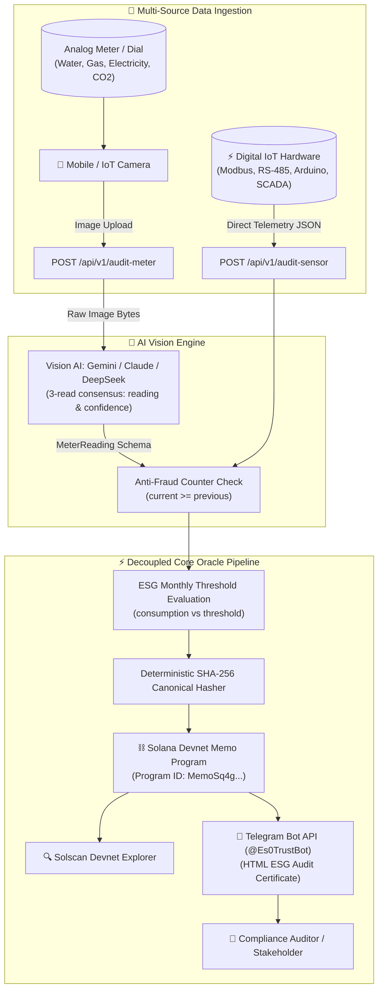

# 🌿 EcoTrust Oracle — B2B SaaS Physical ESG Oracle

[](https://solscan.io/?cluster=devnet)
[](https://python.org)
[](https://fastapi.tiangolo.com)
[](https://nextjs.org)
[](#3-configure-credentials-env)
[](https://t.me/Es0TrustBot)
[](LICENSE)

> **Solana Hackathon (AI Track)**  
> **EcoTrust Oracle** is a decentralized physical oracle that bridges real-world industrial infrastructure (water flowmeters, energy cyclometers, and emissions gauges) directly to the **Solana Blockchain**. It eliminates manual audit greenwashing through multimodal AI vision consensus, cryptographic SHA-256 canonical hashing, monthly threshold breach detection, and instant Telegram compliance certificates.

---

## 📱 Live Telegram Compliance Bot: `@Es0TrustBot`

EcoTrust Oracle features an interactive, real-time Telegram bot for instant corporate compliance notifications and live audit tracking:

* **Official Bot Username**: [`@Es0TrustBot`](https://t.me/Es0TrustBot)
* **Direct Link**: [https://t.me/Es0TrustBot](https://t.me/Es0TrustBot)

### How to test the Telegram Bot:
1. Open Telegram and search for **`@Es0TrustBot`** (or click the link above).
2. Press **Start** or send `/start` to register your chat ID. The bot will welcome you and acknowledge your registration.
3. Submit an audit from the Web Dashboard at [http://localhost:3000](http://localhost:3000) (upload a meter photo or submit IoT sensor telemetry).
4. Watch your official ESG compliance certificate arrive in Telegram within ~3 seconds, complete with the direct **Solscan Devnet proof URL** and **monthly consumption threshold evaluation**!
5. Send `/status` to the bot to check Oracle operational health, or `/help` for quick reference commands.

---

## 🎯 The Problem & Our Solution

### ⚠️ The Problem: Greenwashing & Manual Audit Fraud
* Corporate ESG (Environmental, Social, and Governance) compliance relies heavily on manual clipboard inspections.
* Legacy analog meters lack IoT connectivity and cannot be connected to corporate ERPs without multi-million dollar sensor retrofitting.
* Carbon credits and sustainability claims are vulnerable to forgery, backdated meter rollbacks, and auditor collusion.

### 🛡 The Solution: EcoTrust Oracle
* **Physical-to-Chain AI Bridge**: Plant operators take a single photo using any mobile camera or feed direct IoT telemetry.
* **Multi-Provider AI Vision Consensus**: Google Gemini, Anthropic Claude, or DeepSeek inspect the image with 3 independent parallel passes. If reads disagree, confidence drops and the audit is flagged for human review.
* **Anti-Tampering Counter Checks**: Cumulative meters cannot roll back; if a new reading is lower than the previous reading, the system rejects it with HTTP 409 before touching the blockchain.
* **Monthly Consumption Thresholds**: Evaluates net period consumption (`current - previous`) against corporate ESG targets, tagging on-chain Solana Memos as `:EXCEEDED` or `:COMPLIANT`.
* **Solana Memo Program Anchoring**: Anchors the deterministic SHA-256 hash onto **Solana Devnet** via the native Memo Program (`MemoSq4gqABAXKb96qnH8TysNcWxMyWCqXgDLGmfcHr`), creating permanent proof with zero smart contract overhead.
* **Bilingual Landing Page & Web Dashboard**: Full English and Spanish localization with live pipeline tracking and an independent on-chain verifier.

---

## 🏗 End-to-End Architecture



---

## 📋 Strict Module Data Contracts

All modules communicate through strongly-typed Pydantic contracts located in `core/schemas.py`.

### 1. Unified Meter Reading Contract (`MeterReading` in `core/schemas.py`)
```json
{
  "value": 142.85,
  "unit": "kWh",
  "confidence": 0.98,
  "timestamp": "2026-11-08T01:15:31Z",
  "source": "ai_vision",
  "device_id": "MODBUS-FLOW-042"
}
```

### 2. Web3 Oracle Proof (`core/web3_oracle.py`)
```json
{
  "data_hash": "51fad600e9e2efb2e531b063aa6113e7e2d099bf523d8e70e5ae668a50554ee0",
  "tx_signature": "42ZoJjLPsuWz95aJq4Ttzde8FLSPAnpQunuoYbsi1RTakTYdiajcZz5iKXihEkaNcVakUAAeCqJCN6sUWazm2hKD",
  "solscan_url": "https://solscan.io/tx/42ZoJjLPsuWz95aJq4Ttzde8FLSPAnpQunuoYbsi1RTakTYdiajcZz5iKXihEkaNcVakUAAeCqJCN6sUWazm2hKD?cluster=devnet",
  "memo_payload": "EcoTrust:v1:51fad600e9e2efb2e531b063aa6113e7e2d099bf523d8e70e5ae668a50554ee0:EXCEEDED",
  "network": "solana-devnet",
  "is_simulated": false
}
```

### 3. Orchestration Response with ESG Compliance (`main.py`)
```json
{
  "status": "success",
  "reading": {
    "value": 1500.0,
    "unit": "kWh",
    "confidence": 0.99,
    "timestamp": "2026-11-08T15:42:46Z",
    "source": "iot_sensor",
    "device_id": "PLANT-BOILER-01"
  },
  "oracle_proof": {
    "data_hash": "51fad600e9e2efb2e531b063aa6113e7e2d099bf523d8e70e5ae668a50554ee0",
    "tx_signature": "42ZoJjLPsuWz95aJq4Ttzde8FLSPAnpQunuoYbsi1RTakTYdiajcZz5iKXihEkaNcVakUAAeCqJCN6sUWazm2hKD",
    "solscan_url": "https://solscan.io/tx/42ZoJjLPsuWz95aJq4Ttzde8FLSPAnpQunuoYbsi1RTakTYdiajcZz5iKXihEkaNcVakUAAeCqJCN6sUWazm2hKD?cluster=devnet",
    "memo_payload": "EcoTrust:v1:51fad600e9e2efb2e531b063aa6113e7e2d099bf523d8e70e5ae668a50554ee0:EXCEEDED"
  },
  "notification": {
    "sent": true,
    "channel": "telegram",
    "recipient": "8869039555,8618670305,8501356357",
    "message_id": "88,89,90",
    "is_mock": false,
    "error": null
  },
  "consumption": 500.0,
  "compliance": {
    "threshold": 400.0,
    "consumption": 500.0,
    "is_breach": true,
    "excess_percentage": 25.0,
    "status": "EXCEEDED",
    "detail": "El consumo de 500.0 kWh superó el umbral mensual esperado de 400.0 kWh (+25.0% sobreconsumo)."
  },
  "execution_time_ms": 4460.36
}
```

---

## 🛠 Tech Stack

| Domain | Technology | Justification |
|---|---|---|
| **Runtime & Packaging** | Python 3.10+, `uv` | High-performance virtual environment & package management |
| **Orchestration API** | FastAPI, Uvicorn | Async ASGI pipeline with OpenAPI interactive docs |
| **AI Vision** | Google Gemini, Claude, DeepSeek | Multi-read majority consensus voting with structured JSON extraction |
| **Web3 & Blockchain** | Solana Python SDK, `solders` | Sub-second Devnet finality and native Memo program anchoring |
| **Smart Contract Layer** | Native Solana Memo Program | Zero contract maintenance overhead; permanent on-chain audit log |
| **Notifications** | Telegram Bot API (`requests`, poller) | Real-time multi-chat broadcast with interactive bot commands (`@Es0TrustBot`) |
| **Frontend** | Next.js 15, Tailwind CSS, Solana Wallet Adapter | Bilingual Landing Page + Audit Playground with On-Chain Verifier |
| **Data Contracts** | Pydantic v2 & `pydantic-settings` | Runtime validation and deterministic canonical JSON serialization |

---

## 🚀 Quickstart & Setup

### 1. Prerequisites
Install `uv`:
```bash
# Windows (PowerShell)
powershell -ExecutionPolicy ByPass -c "irm https://astral.sh/uv/install.ps1 | iex"

# macOS/Linux
curl -LsSf https://astral.sh/uv/install.sh | sh
```

### 2. Clone and Setup Environment
```bash
git clone https://github.com/DiegoBarreras/EcoTrustOracle.git
cd EcoTrustOracle

# Create venv and install dependencies
uv venv
uv pip install -e .
```

### 3. Configure Credentials (`.env`)
```bash
cp .env.example .env
```
*(Leave empty or set `*_MOCK_FALLBACK=true` to test the complete pipeline offline without credentials!)*

**AI Vision Key Detection**: paste a single key into `VISION_API_KEY` (or `GEMINI_API_KEY`). The provider is detected from its prefix automatically:

| Key Prefix | Provider | Default Model |
|---|---|---|
| `AIza` or `AQ.` | Google Gemini | `gemini-flash-lite-latest` (native structured JSON) |
| `sk-ant-` | Anthropic Claude | `claude-3-5-sonnet-20241022` |
| `sk-` | DeepSeek | `deepseek-chat` |

### 4. Run the Backend Server
```bash
uv run uvicorn main:app --reload --host 0.0.0.0 --port 8000
```

* **Swagger OpenAPI Docs**: [http://localhost:8000/docs](http://localhost:8000/docs)
* **System Health Check**: [http://localhost:8000/health](http://localhost:8000/health)

### 5. Run the Test Suite
```bash
uv run pytest -v
```
*(All 81 unit, contract, integrity, and compliance tests pass in < 7s).*

### 6. Run the Bilingual Frontend (Landing Page + Audit Demo)
```bash
cd frontend
npm install
npm run dev
```
Open [http://localhost:3000](http://localhost:3000) in your browser:
* Explore the **Landing Page** with architectural walkthroughs and feature overviews.
* Click **Launch App** to test the live audit engine (photo or IoT sensor mode).
* Switch between **English (🇺🇸)** and **Spanish (🇲🇽)** instantly with the header toggle.
* Connect **Phantom** or **Solflare** to sign as an identified auditor.
* Use the **On-Chain Verifier** to independently confirm any Solana Devnet transaction hash.

---

## 📡 API Reference

### `POST /api/v1/audit-meter`
**AI Vision Ingestion**: Accepts a photograph of an analog or digital industrial meter, runs 3-read AI consensus, checks counter monotonicity, evaluates against monthly threshold, anchors to Solana Devnet, and alerts Telegram.
* **Form Parameters**:
  * `file`: (Required) Image file (`image/jpeg`, `image/png`, `image/webp`, `image/heic`).
  * `meter_hint`: (Optional) Operator notes (e.g., `"Primary Boiler Flowmeter"`).
  * `device_id`: (Optional) Meter / asset tag (e.g. `"BOILER-03"`).
  * `previous_value`: (Optional) Previous counter reading to compute consumption and prevent fraud.
  * `monthly_threshold`: (Optional) Expected monthly consumption threshold.
  * `telegram_chat_id`: (Optional) Recipient override for ESG certificate.

### `POST /api/v1/audit-sensor`
**Direct IoT Telemetry Ingestion**: Direct structured reading payload from Modbus, SCADA, or IoT hardware. Computes net consumption, evaluates compliance threshold, and anchors proof directly to Solana Devnet.
* **JSON Body**: `MeterReading` schema (`value`, `unit`, `confidence`, `timestamp`, `source`, `device_id`).
* **Query Parameters**: `previous_value`, `monthly_threshold`.

### History, comparison and consumption limits
Send a `device_id` with any audit and the reading is stored (SQLite, `DB_PATH`) and compared with that meter's previous reading: consumption, elapsed time, daily rate vs. typical rate. Readings that look altered (counter going backwards, unit change, abnormal jump) are **still anchored as evidence**, flagged in `comparison.anomaly` and alerted on Telegram.
* `GET /api/v1/devices`: audited meters.
* `GET /api/v1/devices/{device_id}/history`: readings (oldest first) plus limit status.
* `PUT /api/v1/devices/{device_id}/limit` `{"period": "day|week|month", "limit": 500, "unit": "kWh"}`: warning at 80 %, alert at 100 %, with end-of-period projection. `DELETE` removes it.

### `POST /api/v1/bill-check`
**AI bill comparison**: upload the current utility bill, optionally the previous bill and/or a meter photo (or a `device_id` to use its last stored reading). The vision model reads every field 3 times and keeps only fields all reads agree on; **code, not the model**, checks consumption arithmetic, estimated readings, bill vs. meter, continuity, period gaps, consumption and price changes, and estimates any overcharge. The model only writes the plain-language explanation. The checks are anchored on Solana and summarized to Telegram.

### `POST /api/v1/verify` and `POST /api/v1/verify-payload`
Independent verification: recompute the SHA-256 of a reading (or any anchored canonical JSON, e.g. a bill check), fetch the transaction and confirm the memo hash and the oracle signer.

### `POST /api/v1/audit-meter-mock`
Simulates the entire Solana Devnet anchoring & notification pipeline with synthetic data (ideal for frontend developers).

---

## 🛠 Web3 & Solana Devnet CLI Tools (Developer 2)

### 1. Oracle Wallet Manager (`scripts/manage_wallet.py`)
```bash
# Generate dedicated Oracle keypair and automatically configure .env
uv run python scripts/manage_wallet.py generate

# Check Devnet balance in SOL and lamports
uv run python scripts/manage_wallet.py balance

# Request airdrop via RPC
uv run python scripts/manage_wallet.py airdrop
```

### 2. On-Chain Memo Verifier (`scripts/verify_onchain_memo.py`)
Downloads confirmed transactions directly from Solana Devnet, extracts the native Memo Program instruction, and cryptographically proves the reading's integrity to auditors and judges:
```bash
uv run python scripts/verify_onchain_memo.py <TX_SIGNATURE>
```

---

## 👥 Team Delegation

Refer to [`AGENTS.md`](AGENTS.md) and [`ARCHITECTURE.md`](ARCHITECTURE.md) for detailed tasks assigned to:
* **Developer 1 (AI Vision Engineer)**: `core/vision_agent.py`
* **Developer 2 (Web3 & Solana Engineer)**: `core/web3_oracle.py`
* **Developer 3 (Backend Orchestration & Notifier)**: `main.py`, `core/notifier.py`

---

## 📄 License
MIT License. Built for the Solana Hackathon (AI Track).
